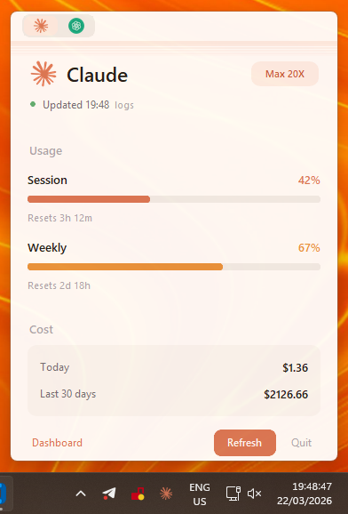
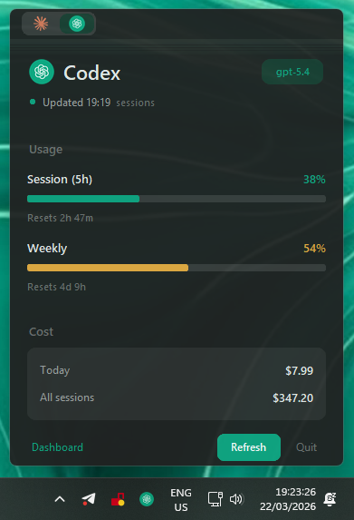

# CodexBar for Windows

> System tray app that shows your **real Claude Code & OpenAI Codex usage** — session limits, weekly limits, reset times, and API costs — right from the Windows taskbar.

Windows port of [steipete/CodexBar](https://github.com/steipete/CodexBar) for macOS.


<p align="center">
  
  
</p>

## Security note (please read)

**Releases v1.0.0 – v1.1.2 shipped a PyInstaller `CodexBar.exe` that antivirus engines
flag as a trojan/infostealer. Those binaries have been removed and are no longer
available.** The detection was triggered by two things:

1. A fallback that read the `sessionKey` cookie from Chrome/Edge/Brave (copying the
   cookie database and decrypting it with DPAPI + AES-GCM) to call the Claude.ai usage
   API. That is the exact technique used by real infostealers, and AV heuristics cannot
   tell the difference — even though the cookie was only ever sent to `api.claude.ai`.
2. An unsigned, single-file PyInstaller executable, which is a common false-positive source
   on its own.

Nothing was ever exfiltrated, but shipping browser-cookie-decryption code was the wrong
design. As of this commit the app **never touches your browser**: it only uses the
Claude Code CLI and the credentials file Claude Code already stores locally.
No prebuilt executables are distributed anymore — run it from source so you can read
exactly what it does.

If you downloaded an old `CodexBar.exe`, delete it. There is nothing else to clean up.

## Install (run from source)

```bash
git clone https://github.com/babakarto/CodexBar-Win.git
cd CodexBar-Win
pip install -r requirements.txt
python codexbar.py
```

Or double-click `CodexBar.bat` — it installs dependencies and launches.

## Requirements

- **Windows 10 or 11**
- **Claude Code CLI** installed and logged in (`claude` in PATH)
- Python 3.10+

## Features

- **Dual provider** — Claude Code + OpenAI Codex tabs with smooth animated transitions
- **Live usage bars** — session and weekly limits with color-coded percentages
- **Reset countdowns** — know exactly when your limits refresh
- **Cost tracking** — today's spend and 30-day totals from local logs
- **Native popup** — customtkinter window with rounded corners, slide-up animation
- **Provider branding** — Claude orange palette + OpenAI dark/green theme, tray icon switches per tab
- **Smart default tab** — opens on Codex (with the OpenAI tray icon) when Claude Code is not installed
- **Auto-refresh** — updates every 5 minutes
- **Zero config** — reads everything Claude Code already stores locally

## How It Gets Data

CodexBar tries multiple methods in order, using the first that succeeds:

| Priority | Method | What it does |
|----------|--------|-------------|
| 1 | **CLI (PTY)** | Spawns interactive `claude` via pseudo-terminal, sends `/usage`, parses output |
| 2 | **OAuth token** | Reads `~/.claude/.credentials.json`, calls Claude.ai API |
| 3 | **JSONL logs** | Scans `~/.claude/projects/` for conversation logs (always runs for cost data) |

## macOS vs Windows

| | [CodexBar](https://github.com/steipete/CodexBar) (macOS) | CodexBar-Win (Windows) |
|---|---|---|
| **UI** | SwiftUI menu bar popup | customtkinter system tray popup |
| **Language** | Swift | Python |
| **Providers** | 16+ (Claude, Cursor, Copilot, Gemini...) | Claude Code + OpenAI Codex |
| **Data source** | CLI PTY | CLI PTY → OAuth → JSONL |
| **Install** | `brew install --cask steipete/tap/codexbar` | Run from source (`pip install -r requirements.txt`) |
| **Auto-update** | Sparkle framework | `git pull` |
| **Browser access** | Keychain cookie read | None |
| **Size** | ~5 MB (native) | ~80 KB of Python (plus deps) |
| **License** | MIT | MIT |

## Troubleshooting

| Problem | Fix |
|---------|-----|
| No usage data shown | Make sure `claude` is in PATH and you're logged in |
| "winpty not found" | `pip install pywinpty` |
| Popup doesn't appear | Check the system tray overflow area (click ^ arrow near clock) |
| CLI shows 0% | Another Claude Code session may be running — CodexBar spawns its own PTY |

## Credits

Windows port inspired by [steipete/CodexBar](https://github.com/steipete/CodexBar) (MIT) by [Peter Steinberger](https://steipete.me) — the original macOS menu bar app.

## License

MIT
